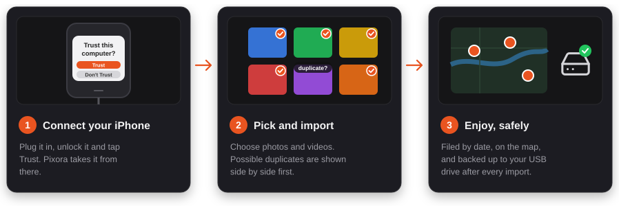
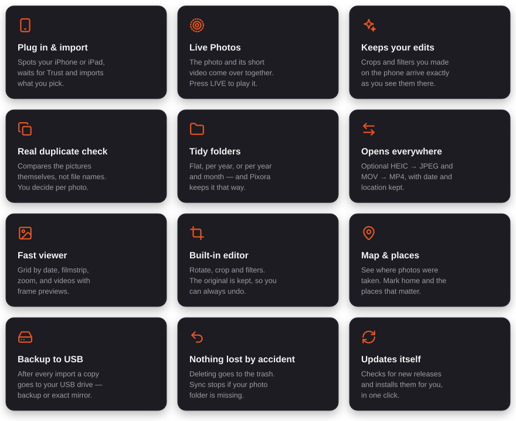

<p align="center">
  
</p>

<p align="center">
  <strong>Your iPhone photos and videos — imported, tidied and backed up on your own Linux PC.</strong><br>
  <sub>Not affiliated with or endorsed by Apple.</sub>
</p>

<p align="center">
  
  
  
  
  
</p>

---

## What is it?

Pixora is a photo and video manager for Linux, made for people with an **iPhone or iPad**. Plug your phone in, pick what you want, and Pixora copies it to your computer — with your edits, your Live Photos and the right date and place.

It then keeps your library **tidy**: everything filed by date, duplicates caught by looking at the pictures themselves, and a copy on your **USB drive** after every import.

Everything happens **on your own machine**. No account, no cloud, no subscription.

## How it works

<p align="center">
  
</p>

1. **Connect** your iPhone or iPad with a USB cable, unlock it and tap *Trust*.
2. **Pick** the photos and videos you want. If something already looks like it's in your library, you see both side by side and decide.
3. **Enjoy**: browse by date, see your photos on a map, edit them — while Pixora backs everything up to your USB drive.

## What you can do

<p align="center">
  
</p>

## Supported languages

<p align="center">
  
</p>

## What you need

- **A recent Ubuntu or a distribution based on it** — see the table below.
- **An iPhone or iPad** and its USB cable (Lightning or USB-C).
- **Internet**, only for: installing, map tiles, looking up an address you type in, and checking for updates.

### Which Linux?

Pixora is built for **GNOME** and looks most at home there. It needs **libadwaita 1.5 or newer**, which decides where it runs:

| Distribution | Works? |
| --- | --- |
| Ubuntu 24.04 LTS and newer | ✅ Made and tested here |
| Kubuntu, Xubuntu, Lubuntu, Ubuntu MATE 24.04+ | ✅ Should work — it looks like a GNOME app there |
| Linux Mint 22+, Pop!_OS 24.04+, Zorin OS 18+ | ✅ Should work (based on Ubuntu 24.04) |
| Debian 13 "Trixie" and newer | ✅ Should work |
| Ubuntu 22.04, Debian 12, Linux Mint 21 | ❌ Too old — the installer tells you so |
| Fedora, Arch, openSUSE | ❌ Not yet: the installer uses `apt` |

On other desktops (KDE, Xfce, Cinnamon, LXQt) Pixora works the same; you just need a polkit agent for password prompts, which every desktop above has.

## Install

Open a terminal and paste:

```bash
curl -fsSL https://raw.githubusercontent.com/Linux-Ginger/Pixora/main/install.sh | bash
```

It asks for your password once, installs what Pixora needs, and opens the installer. Pick **Install**, and Pixora starts by itself. A setup wizard then asks where your photos should go and whether you want a USB backup.

### Updating

Pixora checks for new releases by itself. You can also check yourself: **Settings → About → Check for updates**. The release notes are right there under *What's new*.

### Uninstalling

```bash
curl -fsSL https://raw.githubusercontent.com/Linux-Ginger/Pixora/main/uninstall.sh | bash
```

Your photo library is never touched. The untouched originals of photos you edited are kept too (in `~/.local/share/pixora-originals`), so nothing is lost.

## Privacy

Pixora is offline-first. Your photos, videos and library never leave your computer.

- **Places on the map**: to show a street name, Pixora asks OpenStreetMap ([Nominatim](https://nominatim.org/)) for the place at a photo's GPS position, once per spot. Addresses you type in for *Home* and *Places* are looked up the same way. Only coordinates or that address are sent — never photos.
- **Map tiles** come from OpenStreetMap and are cached on your computer, so the map also works offline.
- **Updates**: Pixora asks GitHub whether a newer release exists.
- **Settings** stay in `~/.config/pixora/`, readable only by you.

<details>
<summary><strong>For techies</strong></summary>

<br>

**Built with** Python 3, GTK 4 + libadwaita (PyGObject), WebKitGTK + Leaflet for the map, GStreamer for video, Pillow + pillow-heif for images, imagehash for duplicate detection, `libimobiledevice` + `ifuse` to talk to the phone, `rsync` for backups and `ffmpeg` for video thumbnails and conversion.

**Layout**

| Path | What |
| --- | --- |
| `viewer/main.py` | Entry point (setup wizard on first run, else the main window) |
| `viewer/main_window.py` | Main window: startup, header, services, shutdown |
| `viewer/win_*.py` | One file per feature: grid, viewer, video, editor, delete, map, places, settings, library tools, backup, about |
| `viewer/importer_page.py` | Importing from the iPhone/iPad |
| `viewer/common.py`, `metadata.py`, `media.py`, `drives.py` | Shared helpers: logging/i18n, EXIF & GPS cache, thumbnails, external drives |
| `deps/` | The one list of system and Python packages, plus the script that installs them |
| `locale/` | Translations (gettext) |
| `tests/` | Safety tests for backup, import and delete |
| `tools/readme_art.py` | Generates the pictures in this README |

**Run from a checkout**

```bash
git clone https://github.com/Linux-Ginger/Pixora.git
cd Pixora
sudo bash deps/install-system-deps.sh
python3 -m pip install --user --break-system-packages -r deps/python-packages.txt
python3 viewer/main.py
```

**Tests**

```bash
python3 -m unittest discover tests
```

**Developer mode** (*Settings → Advanced*) opens Pixora with a log terminal and writes `~/.cache/pixora/pixora.log`.

**Translations** live in `locale/<lang>/LC_MESSAGES/pixora.po`; Pixora compiles them on start. To refresh the template: `xgettext --language=Python --keyword=_ --keyword=ngettext:1,2 -o locale/pixora.pot viewer/*.py installer.py`.

**Releases**: bump `viewer/version.py`, then publish a GitHub release tagged `v<version>` (e.g. `v1.68.0`). Normal users only ever get these. **Pre-releases** are tagged `v<version>-pre.<n>` (e.g. `v1.69.0-pre.1`) and marked *Pre-release* on GitHub; only Pixora's in developer mode with *Settings → About → Test pre-releases* switched on look at them. Pixora is alpha, so older releases (and their tags) are removed when a new one is published.

</details>

## Credits

<p align="center">
  
</p>

Pixora is vibecoded by **Linux Ginger** together with **Claude** (Anthropic). The map uses [Leaflet](https://leafletjs.com/) and [Leaflet.markercluster](https://github.com/Leaflet/Leaflet.markercluster), with map data © [OpenStreetMap contributors](https://www.openstreetmap.org/copyright).

## Licence

Pixora is free and open source under the [**GNU GPL v3.0**](LICENSE). You may use it, study it, change it and share it — as long as your version stays under the same licence.

## Trademarks

iPhone, iPad and Live Photos are trademarks of Apple Inc. Ubuntu is a trademark of Canonical Ltd. Pixora is an independent project and is not affiliated with or endorsed by either company; the names are only used to explain what Pixora works with.

---

<p align="center"><sub>Made with ❤ by Linux Ginger &amp; Claude · <a href="https://linuxginger.com/pixora">linuxginger.com/pixora</a></sub></p>
